

  <a href="https://lowcodestacks.com/components">
    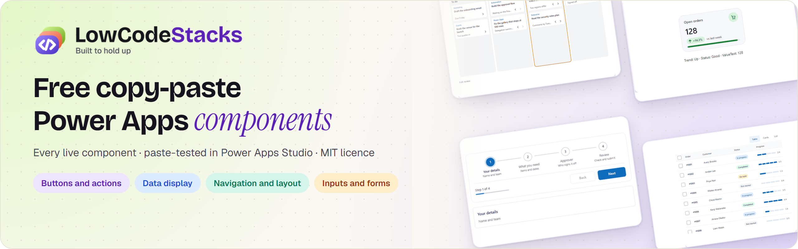
  </a>

  
  
  
  
  

  <a href="#browse-by-category"><strong>Browse</strong></a>
  &nbsp;·&nbsp;
  <a href="#use-one-in-three-steps">Quick start</a>
  &nbsp;·&nbsp;
  <a href="#questions">Questions</a>
  &nbsp;·&nbsp;
  <a href="https://lowcodestacks.com/components">Live demos</a>
  &nbsp;·&nbsp;
  <a href="https://lowcodestacks.com/guides">Guides</a>
  &nbsp;·&nbsp;
  <a href="https://www.linkedin.com/company/lowcodestacks/">LinkedIn</a>

# Power Apps components

Free copy-paste components for Power Apps canvas apps, from [LowCodeStacks](https://lowcodestacks.com). Every component that's live on [lowcodestacks.com/components](https://lowcodestacks.com/components) is here: each folder holds its YAML and the steps to paste it into Power Apps Studio. Every one is paste-tested in Studio before it's published, and none needs a premium licence.

> [!TIP]
> Each component also has a live demo on [lowcodestacks.com](https://lowcodestacks.com/components), where you can try every variation and property, read its guide and see its change log.

## Browse by category

  <a href="#buttons-and-actions">Buttons and actions (2)</a>
  &nbsp;·&nbsp;
  <a href="#data-display">Data display (4)</a>
  &nbsp;·&nbsp;
  <a href="#inputs-and-forms">Inputs and forms (1)</a>
  &nbsp;·&nbsp;
  <a href="#navigation-and-layout">Navigation and layout (5)</a>

### Buttons and actions

<table>
  <tr>
    <td width="50%" valign="top">
<a href="button/">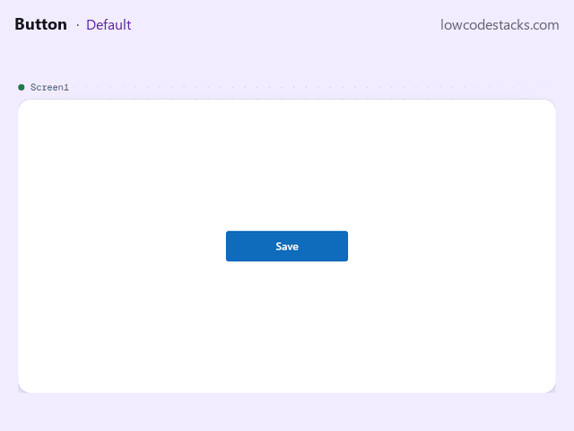</a>
<h3><a href="button/">Button</a> <code>0.3.1</code></h3>

A modern button in four looks, in your brand colour, light or dark.

<a href="https://lowcodestacks.com/components/button"><strong>Live demo and guide</strong></a> · <a href="button/component.yaml">YAML</a> · <a href="button/">Paste steps</a>

    </td>
    <td width="50%" valign="top">
<a href="floating-action-button/">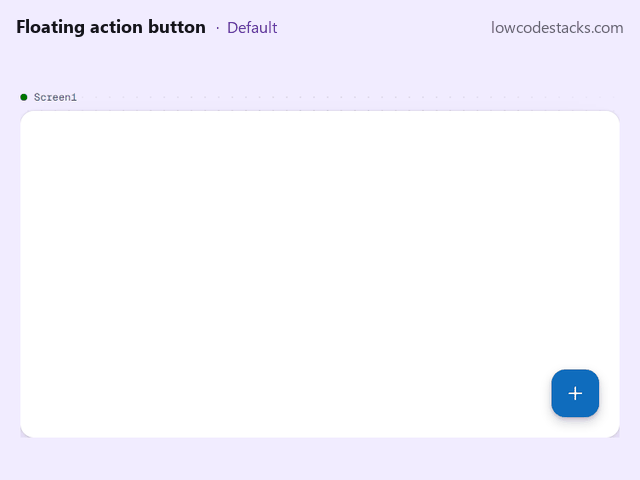</a>
<h3><a href="floating-action-button/">Floating action button</a> <code>0.3.0</code></h3>

The screen's main action, usually Add new, as a floating button: ready with no setup, extended with a label, or opening a speed-dial menu of more actions.

<a href="https://lowcodestacks.com/components/floating-action-button"><strong>Live demo and guide</strong></a> · <a href="floating-action-button/component.yaml">YAML</a> · <a href="floating-action-button/">Paste steps</a>

    </td>
  </tr>
</table>

### Data display

<table>
  <tr>
    <td width="50%" valign="top">
<a href="data-table/">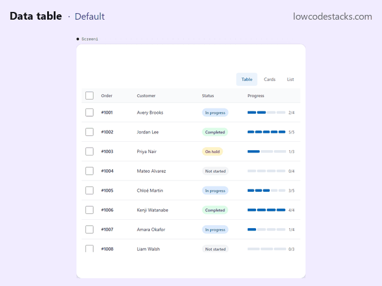</a>
<h3><a href="data-table/">Data table</a> <code>0.2.1</code></h3>

Your rows as a table, cards or a list, with coloured status pills, segmented progress, sortable headers, checkboxes with bulk actions, a row menu, and loading and empty states.

<a href="https://lowcodestacks.com/components/data-table"><strong>Live demo and guide</strong></a> · <a href="data-table/component.yaml">YAML</a> · <a href="data-table/">Paste steps</a>

    </td>
    <td width="50%" valign="top">
<a href="kanban-board/">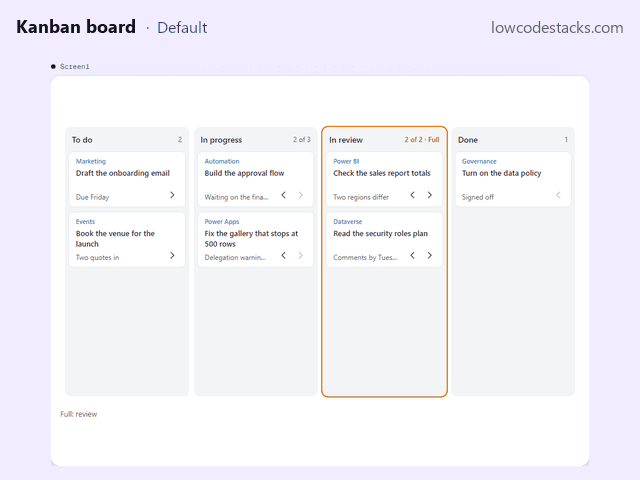</a>
<h3><a href="kanban-board/">Kanban board</a> <code>0.1.0</code></h3>

Columns and cards from two tables, each card moved left or right with a button or the keyboard.

<a href="https://lowcodestacks.com/components/kanban-board"><strong>Live demo and guide</strong></a> · <a href="kanban-board/component.yaml">YAML</a> · <a href="kanban-board/">Paste steps</a>

    </td>
  </tr>
  <tr>
    <td width="50%" valign="top">
<a href="kpi-card/">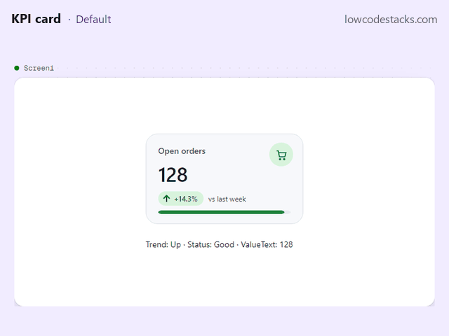</a>
<h3><a href="kpi-card/">KPI card</a> <code>0.1.0</code></h3>

One number with its label as a count, money, a percentage or 12.4K; the change against a previous value, coloured by whether up is good; progress toward a target with a status that follows it; and OnSelect to open the list behind it.

<a href="https://lowcodestacks.com/components/kpi-card"><strong>Live demo and guide</strong></a> · <a href="kpi-card/component.yaml">YAML</a> · <a href="kpi-card/">Paste steps</a>

    </td>
    <td width="50%" valign="top">
<a href="month-calendar/">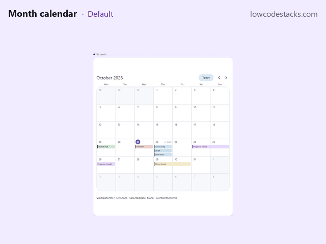</a>
<h3><a href="month-calendar/">Month calendar</a> <code>0.1.0</code></h3>

A month grid from your start of week, events from a table as pills that run across the days they span, +N more past a limit, today marked, a day or an event selectable, previous, next and Today; light and dark, the pills drawing in when the month changes.

<a href="https://lowcodestacks.com/components/month-calendar"><strong>Live demo and guide</strong></a> · <a href="month-calendar/component.yaml">YAML</a> · <a href="month-calendar/">Paste steps</a>

    </td>
  </tr>
</table>

### Inputs and forms

<table>
  <tr>
    <td width="50%" valign="top">
<a href="attachments-list/">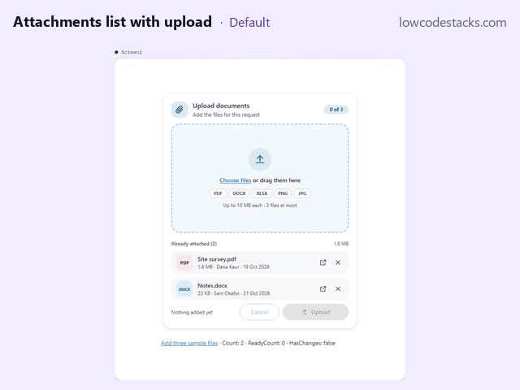</a>
<h3><a href="attachments-list/">Attachments list with upload</a> <code>0.2.0</code></h3>

Adds files and lists the ones already attached: a drop card to choose or drag files in, each with a status and the reason when one can't go, remove and undo for attached files, and one Upload button that hands it all to your app.

<a href="https://lowcodestacks.com/components/attachments-list"><strong>Live demo and guide</strong></a> · <a href="attachments-list/component.yaml">YAML</a> · <a href="attachments-list/">Paste steps</a>

    </td>
    <td width="50%"></td>
  </tr>
</table>

### Navigation and layout

<table>
  <tr>
    <td width="50%" valign="top">
<a href="accordion/">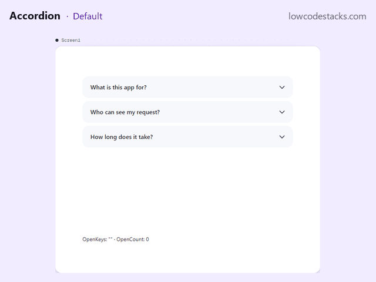</a>
<h3><a href="accordion/">Accordion</a> <code>0.1.0</code></h3>

Expandable sections from a table of titles and text, one open at a time or several, each growing to fit its text; OpenKeys and OnToggle for your app, Toggle, ExpandAll and CollapseAll from it; keyboard-operable headers that say expanded or collapsed; light and dark.

<a href="https://lowcodestacks.com/components/accordion"><strong>Live demo and guide</strong></a> · <a href="accordion/component.yaml">YAML</a> · <a href="accordion/">Paste steps</a>

    </td>
    <td width="50%" valign="top">
<a href="carousel/">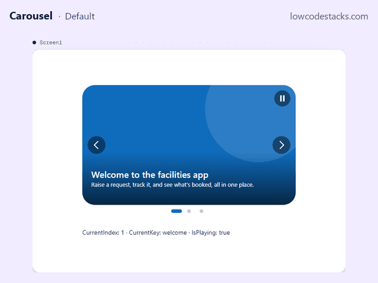</a>
<h3><a href="carousel/">Carousel</a> <code>0.1.0</code></h3>

Slides from a table, each a picture or a colour with a title and text, advancing on a timer with a pause control, dots and arrows, looping or stopping at the end; OnChange and OnSelect, Next, Previous, GoTo, Play and Pause; light and dark, each slide fading in.

<a href="https://lowcodestacks.com/components/carousel"><strong>Live demo and guide</strong></a> · <a href="carousel/component.yaml">YAML</a> · <a href="carousel/">Paste steps</a>

    </td>
  </tr>
  <tr>
    <td width="50%" valign="top">
<a href="navigation-shell/">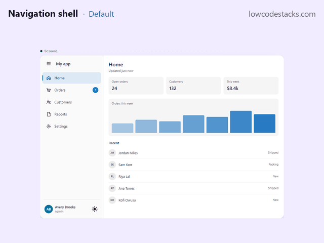</a>
<h3><a href="navigation-shell/">Navigation shell</a> <code>0.2.0</code></h3>

Your app's main menu: a side menu on wide screens that collapses to icons, and a bottom bar on phones, from one table.

<a href="https://lowcodestacks.com/components/navigation-shell"><strong>Live demo and guide</strong></a> · <a href="navigation-shell/component.yaml">YAML</a> · <a href="navigation-shell/">Paste steps</a>

    </td>
    <td width="50%" valign="top">
<a href="stepper/">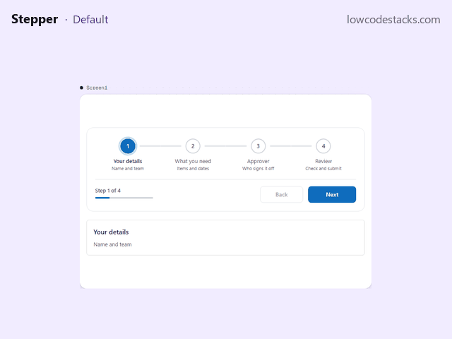</a>
<h3><a href="stepper/">Stepper</a> <code>0.3.1</code></h3>

The steps of a form or wizard, with progress, a check before each step that stops people skipping what's required, Back and Next, and a step to go to.

<a href="https://lowcodestacks.com/components/stepper"><strong>Live demo and guide</strong></a> · <a href="stepper/component.yaml">YAML</a> · <a href="stepper/">Paste steps</a>

    </td>
  </tr>
  <tr>
    <td width="50%" valign="top">
<a href="tree-view/">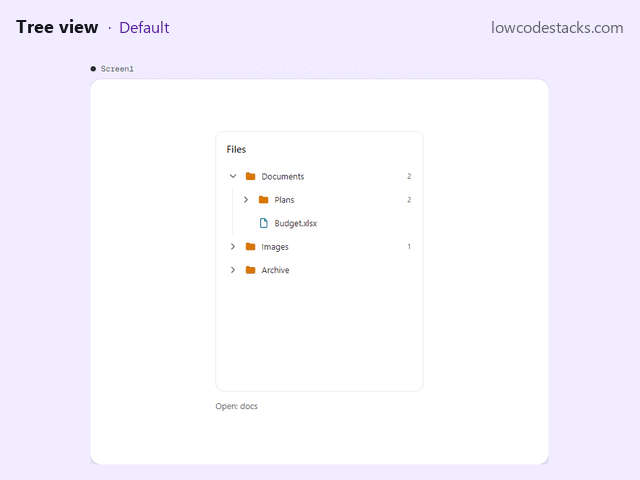</a>
<h3><a href="tree-view/">Tree view</a> <code>0.2.0</code></h3>

Folders, categories or an org chart as a tree that opens and closes, from one flat table, in one gallery.

<a href="https://lowcodestacks.com/components/tree-view"><strong>Live demo and guide</strong></a> · <a href="tree-view/component.yaml">YAML</a> · <a href="tree-view/">Paste steps</a>

    </td>
    <td width="50%"></td>
  </tr>
</table>

## Every component at a glance

| Component | Category | Version | Name in Studio | Links |
| :- | :- | :- | :- | :- |
| [Accordion](accordion/) | Navigation and layout | `0.1.0` | `lcsAccordion` | [YAML](accordion/component.yaml) · [Live demo](https://lowcodestacks.com/components/accordion) |
| [Attachments list with upload](attachments-list/) | Inputs and forms | `0.2.0` | `lcsAttachmentList` | [YAML](attachments-list/component.yaml) · [Live demo](https://lowcodestacks.com/components/attachments-list) |
| [Button](button/) | Buttons and actions | `0.3.1` | `lcsButton` | [YAML](button/component.yaml) · [Live demo](https://lowcodestacks.com/components/button) |
| [Carousel](carousel/) | Navigation and layout | `0.1.0` | `lcsCarousel` | [YAML](carousel/component.yaml) · [Live demo](https://lowcodestacks.com/components/carousel) |
| [Data table](data-table/) | Data display | `0.2.1` | `lcsDataTable` | [YAML](data-table/component.yaml) · [Live demo](https://lowcodestacks.com/components/data-table) |
| [Floating action button](floating-action-button/) | Buttons and actions | `0.3.0` | `lcsFab` | [YAML](floating-action-button/component.yaml) · [Live demo](https://lowcodestacks.com/components/floating-action-button) |
| [Kanban board](kanban-board/) | Data display | `0.1.0` | `lcsKanban` | [YAML](kanban-board/component.yaml) · [Live demo](https://lowcodestacks.com/components/kanban-board) |
| [KPI card](kpi-card/) | Data display | `0.1.0` | `lcsKpiCard` | [YAML](kpi-card/component.yaml) · [Live demo](https://lowcodestacks.com/components/kpi-card) |
| [Month calendar](month-calendar/) | Data display | `0.1.0` | `lcsMonthCalendar` | [YAML](month-calendar/component.yaml) · [Live demo](https://lowcodestacks.com/components/month-calendar) |
| [Navigation shell](navigation-shell/) | Navigation and layout | `0.2.0` | `lcsNavShell` | [YAML](navigation-shell/component.yaml) · [Live demo](https://lowcodestacks.com/components/navigation-shell) |
| [Stepper](stepper/) | Navigation and layout | `0.3.1` | `lcsStepper` | [YAML](stepper/component.yaml) · [Live demo](https://lowcodestacks.com/components/stepper) |
| [Tree view](tree-view/) | Navigation and layout | `0.2.0` | `lcsTreeView` | [YAML](tree-view/component.yaml) · [Live demo](https://lowcodestacks.com/components/tree-view) |

## Use one in three steps

1. Open the component's folder.
2. Copy everything in `component.yaml`.
3. Follow the paste steps in that folder's `README.md`: turn on the Studio settings it names, then paste into a new component on the **Components** tab.

## Questions

<strong>Do I need a premium licence?</strong>

 
No. They're built from standard controls and use no connectors.

<strong>Which Power Apps Studio settings do they need?</strong>

 
<strong>Enhanced component properties</strong> must be on, and some also need <strong>Modern controls and themes</strong>. Each folder's README says which, under <strong>Add it to your app</strong>.

<strong>Can I use them in a commercial app?</strong>

 
Yes. They're under the <a href="LICENSE">MIT License</a>: use, change and ship them, keeping the licence notice.

<strong>How do I hear about new components and updates?</strong>

 
Watch this repository, or follow <a href="https://www.linkedin.com/company/lowcodestacks/">LowCodeStacks on LinkedIn</a>. Each component's page on <a href="https://lowcodestacks.com/components">lowcodestacks.com</a> has its change log, and the version here always matches the live one.

<strong>Something isn't working. Where do I say?</strong>

 
Use <strong>Report a problem</strong> on the component's page on the site, or open an issue here with the component, its version and what you saw.

## Licence

[MIT](LICENSE). Use them in any app, including commercial ones.

---

  <a href="https://lowcodestacks.com">
    <picture>
      <source media="(prefers-color-scheme: dark)" srcset="assets/logo-on-dark.png">
      <source media="(prefers-color-scheme: light)" srcset="assets/logo.png">
      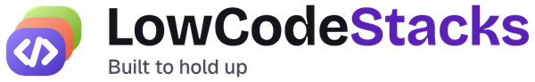
    </picture>
  </a>

Microsoft, Power Apps and Power Platform are trademarks of the Microsoft group of companies. LowCodeStacks is independent and not affiliated with, endorsed or sponsored by Microsoft.

